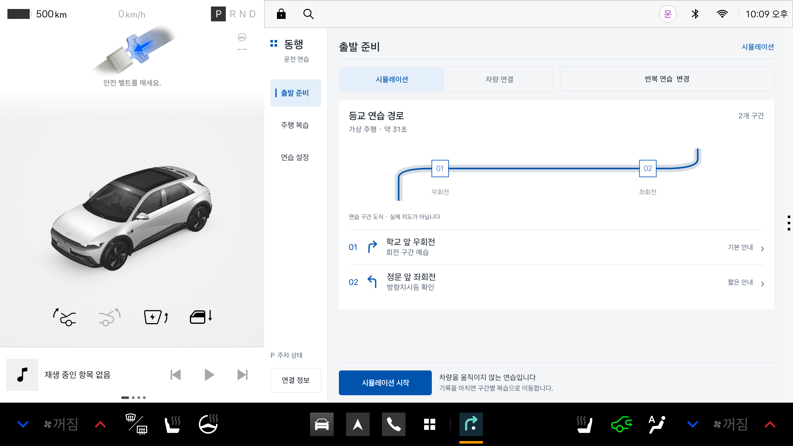

# 동행

초보 운전자가 자주 다니는 경로에서 어려운 구간을 복습하고, 다음 주행에 필요한 도움을 선택해 반복 연습하는 Pleos Connect 앱입니다.



## 실행 방법

1. Pleos Connect 에뮬레이터를 실행하고 운전자 프로필이 준비될 때까지 기다립니다.
2. 아래 서명된 릴리스 APK를 설치하고 앱 목록에서 **동행**을 엽니다.
3. P 기어 상태에서 **출발 준비 → 시나리오 재생 → 첫 주행 → 시작**을 선택합니다. 주행 복습에서 구간별 목표와 도움 수준을 정하고 반복 연습을 시작합니다.

```powershell
adb install -r "apk/PAL223_동행_release.apk"
```

소스로 실행하려면 Android Studio에서 저장소 루트를 열고 Gradle JDK를 17로 설정합니다. Android SDK Platform 35 및 Build Tools 35.0.0을 설치한 뒤 Gradle Sync를 실행하고, 기기 목록에서 Pleos AVD를 선택해 `app` 구성을 실행합니다. 최초 동기화에는 인터넷 연결이 필요합니다. Windows에서는 `local-dev.ps1.example`을 참고해 `BUILD_APP.cmd`와 `RUN_APP.cmd`를 사용할 수 있습니다.

## 테스트 환경과 설정

- Pleos Connect v2.1.0 / Android API 34, 가로 2560 × 1440 px, 160 dpi
- JDK 17, Gradle Wrapper 8.10.2, 앱 패키지 `ai.pleos.coach`
- 시나리오 재생에는 합성 데이터가 사용됩니다. 차량 신호를 확인하려면 앱에서 요청하는 권한을 허용하고, 실제 경로 시험에는 [경로 설정 안내](docs/live-validation.md)를 따릅니다.

## 제출용 APK

[PAL223_동행_release.apk 다운로드](apk/PAL223_%EB%8F%99%ED%96%89_release.apk)

- 경로 `apk/PAL223_동행_release.apk`
- SHA-256 `8125e3855594e69d061339ec6bc54cb3ff84d26624a16f66223c1980a49e4249`

[앱 구조](docs/architecture.md) · [검증 기록](docs/verification.md) · [의존성과 에셋](docs/dependencies.md)
