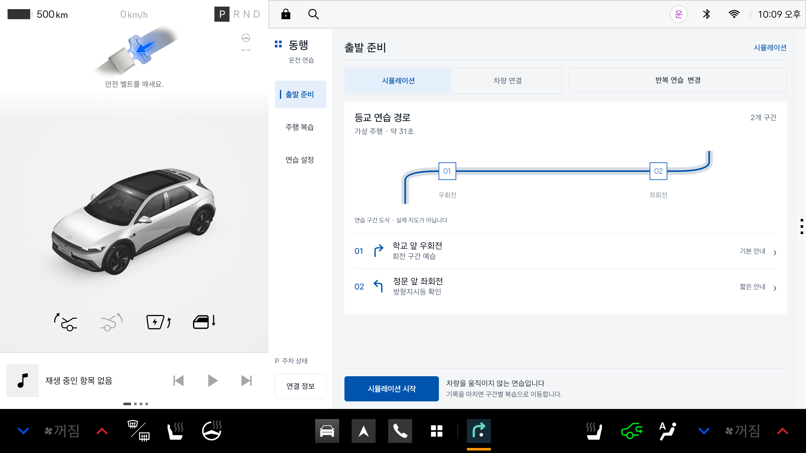

# 동행 UI 개편 · 2026-10-26

Pleos 디자인 원칙을 참고한 독립 앱 디자인입니다. 현대차 공식 앱 또는 인증을 의미하지 않습니다.

- 회백색 바탕, 블루 강조, 평면 구성과 간결한 문구.
- Pleos 권장 Asta Sans 글꼴 및 OFL 라이선스 포함.
- 주요 터치 영역 76dp 이상, 버튼 80dp, 본문 24sp, 주요 제목 32–48sp.
- 준비 / 주행 / 복습 / 연습 설정의 정보 우선순위 분리.
- 하단에 시작·저장 버튼 고정, 설정의 미저장 변경 확인.
- 주행 화면 간소화, 시스템 야간 테마 대응, uiMode 전환 시 기록 유지.
- 그래프 축 통일, 누락은 선 끊김과 물음표로 표시.

검증: APK 빌드, 테스트 21개, lint 오류 0. 에뮬레이터에서 준비·설정·복습 화면, 설정 저장과 미저장 경고를 확인했습니다. 추가 주행·야간 시각 검증은 제어 연결 중단으로 완료하지 못했습니다.

상대 휘도 기준 텍스트 대비: 주간 본문 15.00:1, 보조 6.32:1, 선택 6.29:1 / 야간 본문 16.77:1, 보조 8.97:1, 선택 6.09:1. 실제 차량의 눈부심·진동·시선 이탈 시간과 도달 거리는 아직 검증하지 않았습니다.

참고:
- https://document.pleos.ai/en/docs/connect/guide/docs-design/Introduction/intro
- https://document.pleos.ai/en/docs/connect/guide/docs-design/foundations/typography
- https://developers.google.com/cars/design/automotive-os/design-system/sizing

### 페달·방향지시등 시각화

주행의 관찰 속도 옆에 브레이크 페달과 좌우 방향지시등을 함께 배치했습니다.
앱 내부의 해상도 독립 벡터 그림으로, 주야간 색상과 화면 밀도에 맞춰 그립니다.

- 브레이크: 고정 축과 넓은 고무 발판, 네 줄의 홈으로 표현합니다. 눌림·해제 전환 시 220ms 동안 발판이 짧게 이동하고 눌린 상태는 블루로 구분합니다. 입력은 Boolean이므로 압력이나 제동 강도는 표시하지 않습니다.
- 방향지시등: 회전 경로용 꺾인 화살표와 구분되는 계기판 형태의 좌우 화살표입니다. 관찰된 방향만 녹색으로 점멸하고 글자로 좌측·우측을 함께 표시합니다. SDK는 램프의 점멸 위상을 제공하지 않으므로 1Hz의 앱 표현이며 실제 램프 타이밍 재현은 아닙니다.
- 점멸의 어두운 구간에도 해당 방향의 테두리와 상태 문구는 유지합니다. 꺼짐은 빈 화살표, 값 누락은 흐린 그림과 '확인 불가'로 구분합니다.
- 녹화 중이고 화면이 활성 상태일 때만 움직입니다. 재생 일시 정지, 백그라운드, 복습 및 설정에서는 정지된 그림으로 표시합니다. Compose의 표준 애니메이션 API를 사용해 시스템 애니메이션 배율을 따릅니다.
- 복습 그래프의 행 머리와 충분한 폭이 있는 기록 구간에도 같은 그림을 사용합니다. 연습 목표에는 회전 경로·방향지시등·페달 그림을 연결했습니다.
- 화면 읽기는 그림 프레임마다 반복하지 않고, 브레이크/방향지시등의 상태 문구를 읽습니다.

구현: `CoachIndicators.kt`, 연결: `CoachApp.kt`, 복습 그림: `CoachCharts.kt`.
애니메이션 API 참고: [Android Developers](https://developer.android.com/develop/ui/compose/animation/quick-guide).

검증 (2026-10-26):
- Kotlin 본문과 단위 테스트 소스 컴파일 완료.
- 기존 엔진·저장 테스트 21개를 JUnitCore로 직접 실행해 통과.
- lintDebug 오류 0개, 경고 12개. 이번 그림/애니메이션 파일에 대한 오류 없음.
- 새 APK 생성 및 v2 서명 검증 완료. APK의 DEX에 CoachIndicatorsKt 포함 확인.
- 실행 환경에서 Gradle/ADB의 로컬 소켓 연결이 제한됨. 빌드는 Gradle을 단일 프로세스로 실행하고, 프로젝트의 유일한 Java 소스인 생성된 BuildConfig.java를 동일 JDK 17의 javac로 컴파일한 뒤 APK 조립을 수행함. 표준 프로젝트 빌드 설정은 변경하지 않음.
- ADB 서버는 interrupt socketpair 생성 실패로 연결되지 않아 새 APK 자동 설치, 실제 화면 크기/점멸 및 일시 정지·야간 테마의 시각 검증은 미완료.
- 로컬 실행: D:\\Pleos\\RUN_APP.cmd. 이번 APK가 이미 생성되어 있으므로 실행 스크립트가 이 파일을 설치함.
